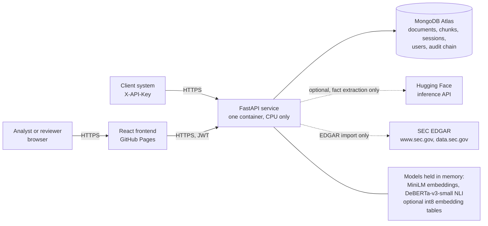
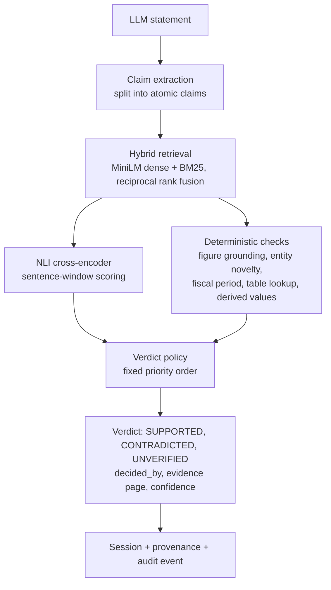

# VERIFIN 2.0 architecture

VERIFIN checks whether statements written by an LLM about a financial report are supported by that report. Every verdict
names the rule that produced it and the evidence page it rests on. This page describes how the parts fit together and why
they are built that way. Operational detail is in [RUNBOOK.md](RUNBOOK.md), security in [THREAT_MODEL.md](THREAT_MODEL.md),
measured quality in [MODEL_CARD.md](MODEL_CARD.md).

## System context

The verification path is fully local. Claim extraction, retrieval, NLI and the verdict rules run inside the container with
models baked into the image, so no document text leaves the deployment while a statement is being checked. The two dotted
connections are optional and off unless configured: the Hugging Face call is used only by the document fact-extraction
endpoint when `HF_TOKEN` is set, and the SEC calls only by the EDGAR import endpoints.

## Verification pipeline

1. **Ingestion** (on upload). The PDF is validated (extension, MIME type, `%PDF-` header, size), hashed (SHA-256), split into
   page-aware chunks stored for retrieval, and its tables are extracted with unit and period detection. Scanned pages go through OCR
   when Tesseract is present.
2. **Claim extraction** splits a statement into atomic claims, repairing sentence splits at abbreviations and keeping each
   sub-claim's subject and reporting period.
3. **Retrieval** returns the top three chunks per claim using dense and BM25 rankings merged by reciprocal rank fusion.
   An optional cross-encoder reranker exists and is off by default (see the model card).
4. **NLI** scores entailment and contradiction between the claim and sentence-sized windows of the evidence, and only the
   windows that align best with the claim are allowed to decide.
5. **Deterministic checks** run in parallel with NLI. They exist because the NLI model alone is unreliable on numbers:
   figure grounding (does the evidence state this figure, or a different one for the same fact), entity novelty (names that
   appear nowhere in the document), fiscal-period alignment, structured-table lookup, and recomputation of derived values
   such as growth and margins.
6. **Verdict policy** (`verdict_policy.py`) applies the checks in a fixed order and returns the first that fires:
   `entity_novelty`, `figure_conflict`, `table_mismatch`, `temporal`, `multi_hop`, `nli`, `grounded_support`. The winning
   rule is stored as `decided_by`, so a reviewer sees why, and the leave-one-out ablation in the README can measure each rule.

A statement's risk is derived from its claims: it is as risky as its worst claim.

## Service layout

| Layer | Where | Responsibility |
|---|---|---|
| API | `app/api/` | versioned routes under `/api/v1` (the unversioned `/api` is kept and marked deprecated) |
| Security | `app/security/` | JWT and API-key authentication, roles (viewer < analyst < admin), tenant scoping, rate limits |
| Services | `app/services/` | ingestion, retrieval, NLI, numeric grounding, verdict policy, export, EDGAR, audit, job runner |
| Repositories | `app/repositories/` | the only code that touches the database; every query is tenant-scoped |
| Observability | `app/observability/` | request IDs and W3C `traceparent`, JSON logs, Prometheus metrics |
| Frontend | `frontend/src/` | React 19, TypeScript, Tailwind v4; token held in `sessionStorage`; route guards by role (see [Frontend](#frontend)) |

### Frontend

A single-page app (Vite, React Router 7, Tailwind v4 with CSS-first tokens, recharts, framer-motion, pdf.js). It talks only to the REST API under `/api/v1`; it holds no verification logic and computes no verdicts. The visual language is documented in [DESIGN_SYSTEM.md](DESIGN_SYSTEM.md).

**Routes** (`frontend/src/App.tsx`; the router `basename` is Vite's `BASE_URL`, so the same build works at `/` and under a Pages sub-path):

| Path | Page | Access |
|---|---|---|
| `/` | landing | public |
| `/login`, `/signup` | sign-in and registration (password, emailed code, Google) | public |
| `/dashboard` | KPIs, recent verifications, verdict mix | signed in |
| `/verify` | upload or paste a statement, "Use sample", "Verify claims" | signed in |
| `/verify/results/:id` | results: verdict counts, risk, claim list, technical details | signed in |
| `/verify/results/:id/claim/:claimId` | one claim's full audit with the PDF evidence viewer | signed in |
| `/history`, `/review`, `/evidence`, `/reports` | history, review queue, evidence explorer, reports (including "Download PDF") | signed in |
| `/analytics`, `/benchmark` | charts of live usage; recorded evaluation results | signed in |
| `/system`, `/settings`, `/account` | engine health; profile, browser preferences and the read-only engine configuration; account details | signed in |
| `/admin` | people, organisation, API keys, audit trail ("Verify integrity") | `RequireRole minimum="admin"` |

**Shell.** Every signed-in route renders inside `components/layout/Layout.tsx`: skip link, `Sidebar` (items from `layout/nav.ts`, collapsible rail on desktop, drawer below 1024px), `Header` (breadcrumb, live `EngineStatus`, "New verification") and an animated `<Outlet />` that fades in on each route change. The only things kept in `localStorage` (via `useStoredState`) are the sidebar collapse state and the preferred retrieval mode.

**State and auth.** There is no global store. Pages fetch with plain hooks and keep their own state; shared concerns are React context: `AuthProvider` / `useAuth` (the current user, login, register, email-code and Google sign-in, logout), `ToastProvider` / `useToast`. The access token lives in `sessionStorage` (`lib/auth.ts`), so closing the tab signs the user out. `RequireAuth` sends anonymous visitors to `/login`; `RequireRole` blocks a role below the minimum; when the backend runs with auth disabled the user is the anonymous local user. Roles are enforced by the API; the route guards only decide what to show.

**API layer.** `lib/api.ts` is the only module that calls the network: one axios instance whose base is `VITE_API_BASE_URL` (`/` means "the origin that served the page", which is how the API-hosted demo build works). It adds the bearer token to every request and, on a 401 from anywhere except the sign-in calls, clears the token and returns to `/login`. Its TypeScript interfaces mirror the backend schemas. `lib/demoData.ts` still supplies the sample results for the built-in demo session ids; real sessions always come from the API. The backend key `UNVERIFIED` is shown as "Unverifiable" through `lib/verdict.ts`.

**Charts.** recharts, wrapped by `components/charts/chartKit.tsx` (`ChartCard` with a Chart/Table switch, `Legend`, `TooltipCard`, `VerdictPatterns`, `VerdictBar`, `useChartMotion`) and `VerdictDonut`. Every verdict mark carries an icon or word and a texture as well as its colour, because the fixed verdict palette does not pass colour-blind separation on its own (details in [DESIGN_SYSTEM.md](DESIGN_SYSTEM.md#colour-blind-safety-an-honest-note)). Charts draw once on mount and not at all under reduced motion.

**Build.** `npm run build` runs `tsc -b` then `vite build`. `VITE_BASE` sets the asset base (the Pages workflow sets `/<repository>/`) and `VITE_API_BASE_URL` the API address. For a demo where the API serves the interface, build with both set to `/` (see `frontend/README.md`).

### Analytics

`GET /api/v1/analytics/overview?days=30` (viewer and up) feeds the Analytics page. It loads the organisation's newest 1,000 finished
verifications and their claims, and `app/services/analytics_service.py` (pure functions, no database access) turns them into totals,
a zero-filled daily trend, per-document and per-claim-type verdict mixes, kinds of hallucination, deciding rules, risk levels, a score
histogram and the highest-risk flagged claims. The window is `days` whole UTC calendar days ending today, and the same-length window
before it supplies the comparison. A CONTRADICTED claim counts as a hallucination and UNVERIFIED as unsupported; the hallucination
rate is contradicted claims over all claims. The page shows every chart as a table too. The verdict colours were checked for
colour-blind separation on the white card surface; they do not pass on colour alone, so every verdict mark also carries an icon or
word and a texture (see [DESIGN_SYSTEM.md](DESIGN_SYSTEM.md#colour-blind-safety-an-honest-note)).

### Benchmark

`GET /api/v1/benchmark/summary` (viewer and up) feeds the Benchmark page. It reads the evaluation harness's recorded test reports
(`data/eval/results/final/report_test.json` and `baselines/report_test.json`) and `app/services/benchmark_service.py` reshapes them:
the systems compared (VERIFIN, the NLI model alone, a number-match heuristic, a 7B language model with and without evidence), the
confusion matrix, per-class scores, accuracy by kind of claim, calibration and latency. Nothing is recomputed or re-run, so the page
shows exactly what the [model card](MODEL_CARD.md) reports. A baseline that was not run is left out rather than invented, and the
endpoint answers 404 when the report files are absent (the Docker image does not copy `data/eval`, so a container shows an empty state).

### Background jobs

`POST /verification/jobs` returns `202` with a status URL immediately. An in-process `JobRunner` runs jobs under a bounded
semaphore (default two at once) with a queue limit (default 50, then `429`). Sessions move `queued`, `running`,
`completed` or `failed`. On start-up the runner marks sessions left unfinished by a crash as `failed`, and on shutdown it
cancels running work. Batch submission accepts up to 25 statements and returns a batch ID.

### Multi-tenancy

Every user belongs to one tenant, created at registration. Every record carries `tenant_id`, repositories filter on it, and a
request for another tenant's record returns `404`, not `403`, so IDs cannot be probed. Roles are read from the database on
each request, so a role change or deactivation applies immediately.

### Audit trail and provenance

- Each tenant has a hash chain: an event stores `seq`, `prev_hash` and its own SHA-256 over its content. `/audit/verify`
  recomputes the chain and reports the first broken sequence number. A unique `(tenant_id, seq)` index prevents two writers
  from forking the chain. Secrets are stripped from event details by key name.
- Every session stores provenance: pipeline version (`verifin-pipeline/4.2`), model identifiers, retrieval and policy
  settings, SHA-256 of the document and of the statement, and per-rule decision counts. It records identifiers and settings
  only, never document text or credentials, so a result can be tied to the exact bytes and rules that produced it.

## Deployment

Frontend on GitHub Pages, API on Cloud Run (one instance, 2 vCPU, 4 GiB, CPU always on), data on a MongoDB Atlas free
cluster. Steps and free-tier limits are in [DEPLOY.md](DEPLOY.md). In `ENVIRONMENT=production` the service forces
authentication on, disables the in-memory database fallback, refuses to start without a strong `JWT_SECRET` or a reachable
database, and hides `/metrics` unless a token is set.

## Design decisions and their costs

| Decision | Reason | Cost |
|---|---|---|
| Deterministic rules around a small NLI model | raw NLI scored 66.8 macro-F1 on test; the rules lift it to 95.2 | rules are tuned to the error types seen; tables and new layouts need their own checks (see the model card) |
| No LLM in the verification path | an LLM judge with the same evidence scored 82.2 and took 12 s per claim; verdicts must be reproducible and traceable | no free-text reasoning over multi-step claims beyond the implemented checks |
| One process, in-memory limiter and queue | simplest correct design for one free instance | does not scale out; needs a shared queue and rate-limit store first |
| Per-tenant hash chain, best-effort writes | tamper evidence without an external ledger | a failed audit write is counted and logged but does not fail the request; the chain proves tampering, it does not prevent it |
| Uploaded files on local disk | no object store on the free tiers | files do not survive a restart; verdicts and reports do (Atlas) |
